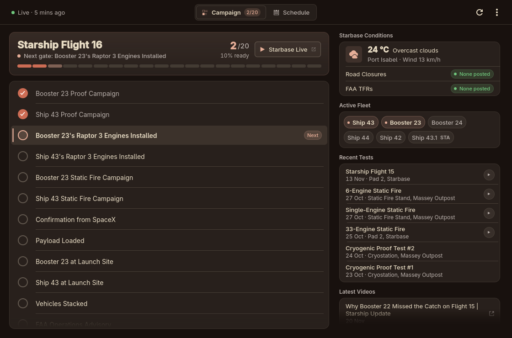

# FlightDeck



Live spaceflight mission control for Omarchy. FlightDeck follows the current
Starship campaign and every launch worldwide, counts down in your bar, alerts
you before liftoff, and copies a checklist or a weekend launch slate ready to
post on X.

Data comes from [Next Spaceflight](https://nextspaceflight.com)'s public API,
which needs no account or key. FlightDeck is not affiliated with Next Spaceflight.

## Pieces

- **`flightdeck daemon`** (Rust) runs as a systemd user service. It polls the
  Starship feed every minute and the launch schedule every 5 minutes, then
  writes `~/.local/share/flightdeck/state.json`. It is the only process that
  writes there; everything else reads that file or calls the CLI.
- **Bar widget** (Quickshell): `FLT 16 3/20 · F9 T-08:51:38`. Left click shows
  the campaign and the next launches, middle click syncs, right click opens
  Mission Control. It dims when the data goes stale or the daemon stops.
- **Mission Control** (Qt Quick): a campaign board (milestones, weather, road
  closures, FAA TFRs, vehicles, tests, videos) and the launch schedule.
- **Alerts** through `omarchy-notification-send`: T-60, T-15 and liftoff for
  launches with a confirmed time, status changes (Hold, Scrub, Success…) within
  a day, newly confirmed Starship milestones, and new closures or TFRs.

Dates the feed hasn't fixed yet are shown as `NET Nov 2026` or `NET Q1 2027`,
never as a countdown to a placeholder.

## External Dependencies

The bar widget (`io.github.cube-one-ber.flightdeck`) runs inside `omarchy-shell` (Quickshell) and reads `~/.local/share/flightdeck/state.json`, populated by the companion `flightdeck` daemon and desktop app in this repository.

- **Runtime:** `qt6-base`, `qt6-declarative`, `qt6-wayland`, `kirigami`, `papirus-icon-theme`, `adwaita-fonts`, `breeze-icons`, `wl-clipboard`, `libnotify`
- **Build:** `cargo`, `gcc`, `make`

## Install

### 1. Install the companion daemon and Mission Control app

```sh
git clone https://github.com/cube-one-ber/FlightDeck.git
cd FlightDeck
bin/install                                         # builds, installs the Arch package, starts flightdeck.service
```

`bin/build` builds in place and `bin/test` runs the Rust and Qt tests.

### 2. Enable the Omarchy bar widget

If you installed via `omarchy plugin add`:

```sh
omarchy plugin add https://github.com/cube-one-ber/FlightDeck.git --enable
```

Or if you used `bin/install` (which symlinks `/usr/share/flightdeck` into `~/.config/omarchy/plugins/io.github.cube-one-ber.flightdeck`):

```sh
omarchy bar put io.github.cube-one-ber.flightdeck
```

## Uninstall / Removal

```sh
omarchy plugin remove io.github.cube-one-ber.flightdeck
systemctl --user disable --now flightdeck.service
sudo pacman -R flightdeck
```

To also remove cached feed state and optional user settings:

```sh
rm -rf ~/.local/share/flightdeck ~/.config/flightdeck
```

## Command line

| Command | What it does |
| --- | --- |
| `flightdeck open` | Opens Mission Control |
| `flightdeck status [--json]` | Shows the campaign, overrides and next launch |
| `flightdeck sync` | Fetches now (asks the daemon to, if it's running) |
| `flightdeck checklist [--copy]` | The campaign as a `✓ / ☐` list |
| `flightdeck weekend [--copy]` | Launches through Sunday in your time zones and UTC |
| `flightdeck milestone <id> on\|off\|auto` | Overrides a milestone until the feed catches up, or hands it back |
| `flightdeck pin <id>` / `pin --clear` | Puts a launch on the bar, or goes back to the next one |

Overrides apply to the current flight only. A pin lapses three hours after
its launch.

## Mission Control shortcuts

| Key | Action |
| --- | --- |
| `1` / `2` / `Ctrl+Tab` | Campaign / Schedule |
| `Tab` | Move focus between controls |
| `J` `K` / `↑` `↓` | Move the selection |
| `Space` / `Enter` | Toggle the milestone override, or pin the launch |
| `L` | Open the selected item's link |
| `R` / `Ctrl+R` | Sync now |
| `C` | Copy the checklist |
| `W` | Copy the weekend slate |
| `F10` | Open the main menu |
| `?` | Show the shortcuts |
| `Q` / `Ctrl+Q` | Quit |

## Settings

`~/.config/flightdeck/config.toml`; every key is optional.

```toml
starship_poll_secs = 60
launches_poll_secs = 300
window_days = 30                          # how far ahead the schedule reaches
alert_minutes = [60, 15, 0]               # [] turns countdown alerts off
timezones = ["Europe/London"]             # for `weekend`; defaults to the system zone
notifications = true
```

## Later

Rendered PNG launch cards, Starship archive export and `ffmpeg` clip presets
were left out of v1.

## License

MIT. See [LICENSE](LICENSE).
